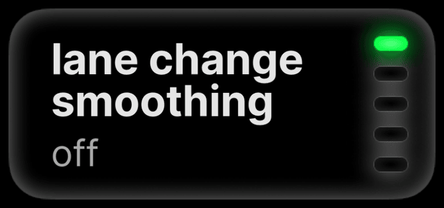
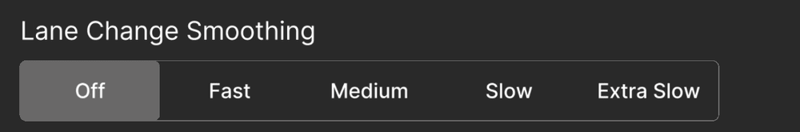

# Lane changes

Lane Change Smoothing makes lane changes slower and smoother, at the pace
you choose. It works on every car.
{ .zp-lede }

## lane change smoothing

Turn it on if lane changes feel abrupt. While parked, open **Settings →
Steering → Lane Change Smoothing** and choose a pace: fast, medium, slow
or extra slow. Every pace is slower than **Off**, the default.

<figure class="setting-shot settings-figure-mici">
  

    
  

  <figcaption>comma 4: Settings → Steering → lane change</figcaption>
</figure>
<figure class="setting-shot settings-figure-tici">
  

    
  

  <figcaption>comma 3X: Settings → Steering → Customize Lane Change</figcaption>
</figure>

## road-edge checks

**Block Lane Change: Road Edge Detection** blocks a lane change toward a
road edge the model sees. Off by default. The model can miss or misread
an edge, so it cannot guarantee a lane change stays on the road.

## blind spots

Cars with blind-spot monitoring pass it to the lane-change system
([Mazda blind spots](sensors-and-alerts.md#blind-spots)). A clear
indicator does not prove the lane is clear; check it yourself.

Other lane-change settings, such as Auto Lane Change by Blinker, are in
the [settings reference](../settings/index.md#steering).
