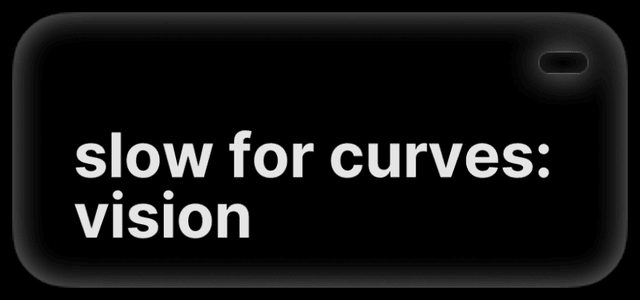
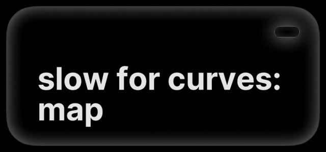

# Slow for Curves

Slow for Curves lowers your speed before a bend and returns to your set
speed afterward, so you don't have to brake and re-set cruise for every
curve. Off by default.
{ .zp-lede }

On Mazda it uses zoompilot's own curve planner. Other brands run
sunnypilot's version unchanged.

## turn it on

While parked, open **Settings → Cruise**:

| Setting | Uses | Requirement |
| --- | --- | --- |
| Slow for Curves: Vision | The driving model's view of the road ahead. | No extra hardware. |
| Slow for Curves: Map | Downloaded road maps. | Download your region through sunnylink first. |

Use Vision, Map, or both. Map does not need Mazda's navigation SD card.
Turn both off to disable curve slowdowns.

<figure class="setting-shot settings-figure-mici">
  

    
    
  

  <figcaption>comma 4: Settings → Cruise</figcaption>
</figure>
<figure class="setting-shot settings-figure-tici">
  

    
    
  

  <figcaption>comma 3X: Settings → Cruise</figcaption>
</figure>

## what to expect

On the car's own cruise, zoompilot lowers the dashboard set speed with
[cruise-button control](speed-limit-assist.md#cruise-button-control)
before a curve and returns it afterward. Press a
cruise-speed button to take over. With
[Alpha Longitudinal](alpha-longitudinal.md), zoompilot brakes for the
curve itself and the dashboard keeps your set speed.

Camera estimates and maps can be wrong or incomplete. Brake whenever
you are too fast for a curve. If a slowdown feels wrong, turn
the feature off and
[share the drive](../help/troubleshooting.md#share-a-drive) with the
location and time.

[How curve speeds are planned](../technical/slow-for-curves.md)
