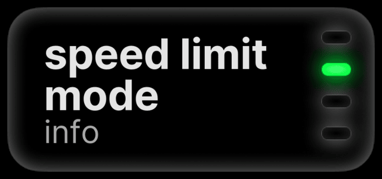
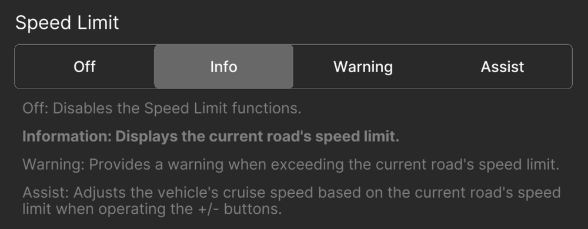

# Speed-Limit Assist

Speed-Limit Assist reads the speed limit from downloaded maps or, on a
Mazda, the car's own sign data. It can show the limit, warn you, or move
your cruise speed to match it.
{ .zp-lede }

## choose a mode

While parked, open **Settings → Cruise → Speed Limit**.

| Mode | Behaviour |
| --- | --- |
| Off | No speed-limit assistance. |
| Info (default) | Shows the limit without changing your cruise speed. |
| Warn | Warns when you exceed the detected limit. |
| Assist | Asks to move your cruise speed to a new limit. |

Only the comma 3X shows the Info and Warn sign display. Assist prompts
appear on both.

<figure class="setting-shot settings-figure-mici">
  

    
  

  <figcaption>comma 4: Settings → Cruise → speed limit</figcaption>
</figure>
<figure class="setting-shot settings-figure-tici">
  

    
  

  <figcaption>comma 3X: Settings → Cruise → Speed Limit</figcaption>
</figure>

## choose a source

The source and offset are next to the mode (comma 3X: source under
**Customize Source**).

- **Car:** on a supported Mazda, the car's speed-limit signs. Needs a navigation SD card.
- **Map:** maps for your region, downloaded through sunnylink.
- **Car-first or map-first:** uses the other source when the preferred one has no limit. Map-first is the default.
- **Combined:** uses the lower limit when both have one.

An offset adds a fixed amount or a percentage to the limit. Start with
none.

## when a limit changes

In Assist, the sign shows an arrow and a chime plays. Press the button
the arrow shows to accept, or the other button to dismiss. Your cruise
speed does not change until you answer. At 50 mph (80 km/h)
and above, a new limit of 50 mph or more applies without a prompt.

Signs and map data can be missing, outdated or wrong. Follow the posted
limit.

## cruise-button control

With Mazda radar cruise, zoompilot changes the set speed by sending the
same + and − presses you would. Older guides call this ICBM. It starts
automatically when a feature needs it; there is no separate switch.

Press a cruise-speed button yourself to choose a new set speed. You can
also set [custom button increments](../settings/index.md#cruise).

[How set speed is managed](../technical/set-speed.md)
