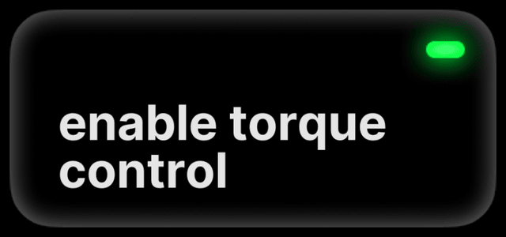
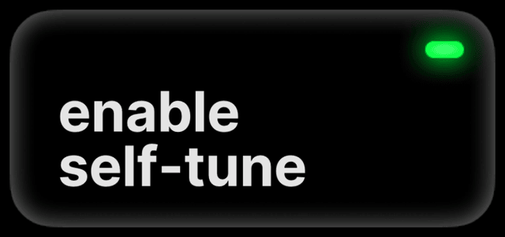
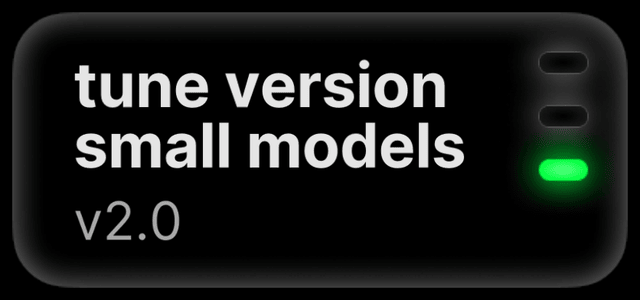

# Steering improvements

zoompilot learns how your car steers at each speed, so it steers more
consistently. Mazdas also get torque limits and a tune matched to their
steering motor.
{ .zp-lede }

## speed-dependent steering

Self-Tune learns how much steering effort your car needs at each speed.
It adapts as you drive, which can make steering smoother over the first
few drives. It works only on cars with torque-based steering. Small and large driving models keep separate tunes.

On a supported Mazda, torque control and Self-Tune are on by default. Leave them on: **Settings → Steering →
torque control** (comma 3X: **Customize Torque Params**). Speed-dependent
learning runs with Self-Tune and has no switch of its own. On other
brands, check that both are available and on.

<figure class="setting-shot settings-figure-mici">
  

    
    
    
  

  <figcaption>comma 4: Settings → Steering → torque control</figcaption>
</figure>
<figure class="setting-shot settings-figure-tici">
  

    
    
    
  

  <figcaption>comma 3X: Settings → Steering → Customize Torque Params</figcaption>
</figure>

## on Mazda

zoompilot matches its torque limits to the Mazda steering motor's
capacity and uses its own tune (v2.0 for small models). Expect more
assistance at low speed and fewer small corrections on the highway. The
motor still has a limit; steer through sharp curves yourself.

A compatible Mazda EPS (2022+) can assist down to a stop. An older EPS
gets the same tune but stops assisting below about 28 mph (45 km/h).
Model year alone does not identify the motor; zoompilot checks the car's
hardware and firmware. [Check your car](../getting-started/supported-cars.md).

If steering feels wrong, see
[troubleshooting](../help/troubleshooting.md#steering-feels-weak-or-wobbly).

## do I need to tune it? { #custom-tune }

I would leave custom tuning and Manual Real-Time Tuning off. Drive
normally and let Self-Tune learn your car. Changing tuning values cannot
raise the motor's torque limit.

If you are looking for the old speed-dependent switch, it now runs with
Self-Tune. There is nothing extra to turn on.

[How steering learns](../technical/steering.md#the-steering-tune)
