# Settings reference

Every setting by panel. For the settings I recommend, see
[Start here](../getting-started/index.md#recommended-settings).
{ .zp-lede }

With a compatible Mazda EPS (2022+), torque control and Self-Tune are on
by default, and Self-Tune learns per speed range. Names give the comma 4
label, then the comma 3X one where it differs. "comma 3X only"
settings have no comma 4 control. Long-press a comma 4 setting for help.
Many settings change only while parked (offroad).

!!! danger "Alpha longitudinal"

    Alpha longitudinal disables Mazda automatic emergency braking and
    forward collision warning. Read [its guide](../features/alpha-longitudinal.md)
    before turning it on.

## Steering

<figure class="settings-strip settings-figure-mici" tabindex="0" aria-label="Steering panel on comma 4, scrolls sideways">
  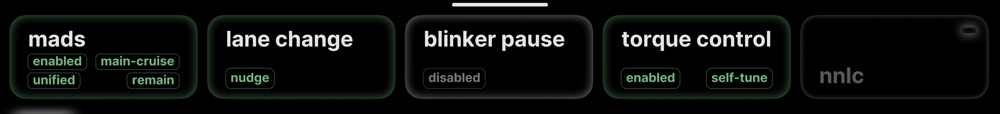
  <figcaption>comma 4</figcaption>
</figure>
<figure class="settings-shot settings-figure-tici">
  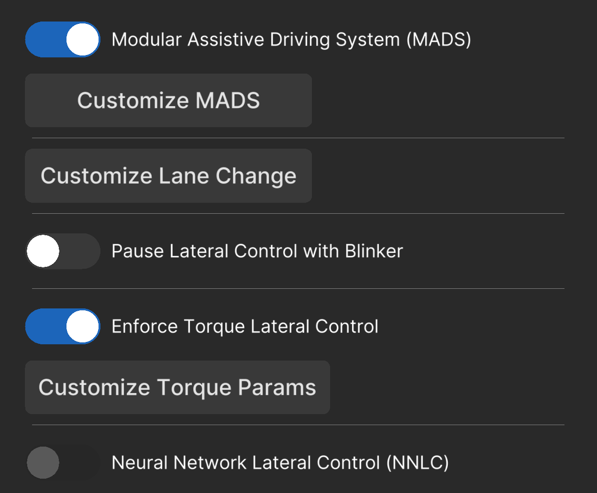
  <figcaption>comma 3X</figcaption>
</figure>

<noscript markdown="1">

| Setting | Default | What it does |
| --- | --- | --- |
| enable mads / Modular Assistive Driving System (MADS) | On | In mads. Lets zoompilot steer while cruise is off. Off: steering and cruise engage together. Offroad only. |
| main cruise toggle / Toggle with Main Cruise | On | In mads. Turning cruise main on also turns steering on. Greyed with MADS off or tja button on. |
| unified engagement / Unified Engagement Mode (UEM) | On | In mads. Engaging cruise also turns steering on, and steering stays on after cruise cancels. Greyed with MADS off or tja button on. |
| steering on brake / Steering Mode on Brake Pedal | remain | In mads. What steering does when you brake. Pause resumes when you let go. Greyed with MADS off. |
| tja button / Mazda TJA Button | Off | In mads. Mazda only. The TJA button becomes the only steering switch; main cruise then controls cruise only. Turn on only if your car has the button. Offroad only. Greyed with MADS off. |
| auto lane change / Auto Lane Change by Blinker | nudge | In lane change. Nudge: signal, then nudge the wheel. Nudgeless and timed modes change lanes on the blinker alone. Signal only when traffic allows. |
| bsm delay / Auto Lane Change: Delay with Blind Spot | Off | In lane change. Waits an extra second after the blind spot clears. Needs blind spot monitoring and nudgeless or a timed mode. |
| road edge block / Block Lane Change: Road Edge Detection | Off | In lane change. Blocks a lane change toward a road edge the model sees. |
| lane change smoothing / Lane Change Smoothing | off | In lane change. Slower, smoother lane changes. Off is stock. |
| enable blinker pause / Pause Lateral Control with Blinker | Off | In blinker pause. Pauses steering while you signal at low speed, so you can turn by hand. |
| blinker speed / Minimum Speed to Pause Lateral Control | 20 | In blinker pause. km/h or mph. Below this speed the blinker pauses steering. Greyed until blinker pause is on. |
| blinker delay / Post-Blinker Delay | 0 s | In blinker pause. Wait before steering resumes after the blinker ends. Greyed until blinker pause is on. |
| enable torque control / Enforce Torque Lateral Control | On for supported Mazdas; otherwise Off | In torque control. Steers with zoompilot's torque tunes. Tune version, self tune and custom tune need it. Offroad only. Greyed while NNLC is on. Not on angle-steering cars. |
| jerk aware / Lateral Jerk Torque Controller | Off | In torque control. Looks ahead to smooth corrections. No gain on Mazdas in testing; leave it off. Offroad only. Greyed while NNLC is on or when every model size runs the v2 tune. |
| tune version (small models) / Torque Control Tune Version (Small Models) | v2.0 for supported Mazdas; otherwise v0.0 | In torque control. The steering tune while a small model drives. Keep the default. Offroad only. Greyed with torque control off. |
| tune version (big models) / Torque Control Tune Version (Big Models) | v1.0 | In torque control. The steering tune while a big model drives. Keep the default. Offroad only. Greyed with torque control off. |
| enable self-tune / Self-Tune | On for supported Mazdas; otherwise Off | In torque control → self tune. Learns how your car steers, per speed range. Needs torque control. Offroad only. Greyed while manual realtime is on. |
| less restrict / Less Restrict Settings for Self-Tune (Beta) | Off | In torque control → self tune. Learns from fewer samples and accepts values further from the car's defaults. Needs self-tune. Offroad only. |
| enable custom tuning / Enable Custom Tuning | Off | In torque control → custom tune. Starts from your own lateral acceleration and friction. Self-tune still learns from there. Recommended off. Offroad only. |
| manual realtime / Manual Real-Time Tuning | Off | In torque control → custom tune. Steers with your values at every speed, ignoring self-tune. Applies within seconds, even while driving. Needs custom tuning. |
| lat accel / Lateral Acceleration Factor | 2.5 | In torque control → custom tune. Higher values steer with less torque. Needs custom tuning. |
| friction / Friction | 0.1 | In torque control → custom tune. Higher values add torque for small corrections. Needs custom tuning. |
| nnlc / Neural Network Lateral Control (NNLC) | Off | Steers with a neural network instead of the torque controller. zoompilot's torque tune is the tested path on Mazda. Offroad only. Greyed while torque control or jerk aware is on. |

</noscript>

## Cruise

<figure class="settings-strip settings-figure-mici" tabindex="0" aria-label="Cruise panel on comma 4, scrolls sideways">
  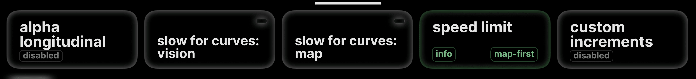
  <figcaption>comma 4</figcaption>
</figure>
<figure class="settings-shot settings-figure-tici">
  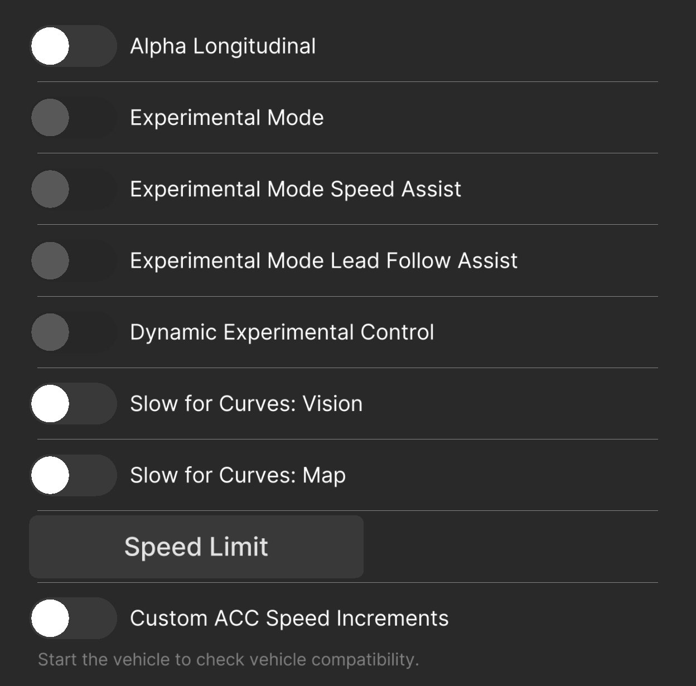
  <figcaption>comma 3X</figcaption>
</figure>

<noscript markdown="1">

| Setting | Default | What it does |
| --- | --- | --- |
| alpha longitudinal / Alpha Longitudinal | Off | In alpha longitudinal. zoompilot controls gas and brakes. Disables Mazda radar, automatic emergency braking, and forward collision warning. On Mazda, needs a compatible Mazda EPS (2022+). Offroad only; asks you to confirm. |
| experimental mode / Experimental Mode | Off | In alpha longitudinal. The driving model controls gas and brakes, including stops for lights and signs. Set speed is a maximum. Greyed without alpha longitudinal on Mazda. |
| speed assist / Experimental Mode Speed Assist | Off | In alpha longitudinal. Raises speed toward your set speed when the road ahead is clear. Needs Experimental Mode. Greyed while Dynamic Experimental Control is on. |
| lead follow assist / Experimental Mode Lead Follow Assist | Off | In alpha longitudinal. Closes an overly long gap behind a steady car, never closer than chill mode. Needs Experimental Mode. Greyed while Dynamic Experimental Control is on. |
| dynamic experimental control / Dynamic Experimental Control | Off | In alpha longitudinal. Switches between chill and Experimental Mode on its own: experimental for stops and slowdowns. Greyed until Experimental Mode is on. |
| slow for curves: vision / Slow for Curves: Vision | Off | Slows for curves the camera sees, then resumes your set speed. Without alpha longitudinal, Mazda uses cruise-button control. Turn on while disengaged. |
| slow for curves: map / Slow for Curves: Map | Off | Slows for curves in map data. Download maps in sunnylink first. Turn on while disengaged. |
| speed limit mode / Speed Limit | info | In speed limit. Assist: press - or + to match a new limit. Info and warn show the sign on comma 3X only. |
| source / Speed Limit Source | map-first | In speed limit (comma 3X: Customize Source). Combined uses the lower. Car needs a nav SD card on Mazda. Map uses downloaded maps. Greyed with speed limit off. |
| offset type / Speed Limit Offset | none | In speed limit. Adds a fixed amount or a percentage to the limit. Greyed with speed limit off. |
| offset value | 0 | In speed limit. km/h, mph, or %. Negative goes below the limit. Greyed until an offset type is set. |
| enable custom increments / Custom ACC Speed Increments | Off | In custom increments. Sets how far + and - move your set speed. Mazda uses cruise-button control. Turn on while disengaged. |
| short press / Short Press Increment | 1 | In custom increments. km/h or mph per tap. Greyed until custom increments is on. |
| long press / Long Press Increment | 5 | In custom increments. km/h or mph per step while holding. Greyed until custom increments is on. |

</noscript>

## Models

<figure class="settings-strip settings-figure-mici" tabindex="0" aria-label="Models panel on comma 4, scrolls sideways">
  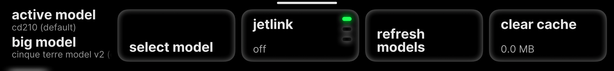
  <figcaption>comma 4</figcaption>
</figure>
<figure class="settings-shot settings-figure-tici">
  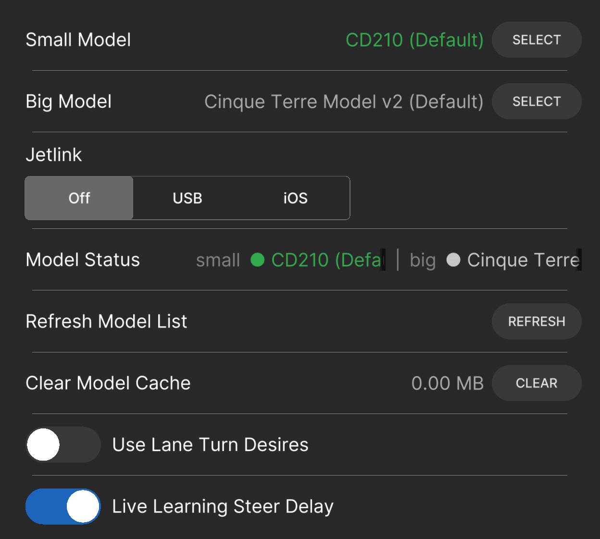
  <figcaption>comma 3X</figcaption>
</figure>

<noscript markdown="1">

| Setting | Default | What it does |
| --- | --- | --- |
| small models / Small Model | Firehose (fm) | In select model. Runs on the comma. Keep the default for your first drive. Offroad only. |
| big models / Big Model | Cinque Terre Model v2, or Jetlink's own default | In select model. Runs on a Chestnut board or over Jetlink. Offroad only. |
| jetlink / Jetlink | off | Runs big models on a computer or phone plugged into the comma. USB for Mac, Jetson, Linux, or Android; iOS for iPhone or iPad. Turns off ADB. Offroad only. Hidden beside a Chestnut board. |
| Use Lane Turn Desires | Off | comma 3X only. At low speed with the blinker on, plans the turn that way, so the car does not pick the wrong turn at a light. |
| Adjust Lane Turn Speed | 19 mph | comma 3X only. Top speed for lane turn desires. Needs the toggle above and Show Advanced Controls. |
| Live Learning Steer Delay | On | comma 3X only. Learns your car's steering response delay. |
| Adjust Software Delay | 0.2 s | comma 3X only. Fixed delay when Live Learning is off. Needs Show Advanced Controls. |
| Adjust Camera Offset | 0 m | comma 3X only. Shifts the model's center. Positive moves it left. Needs Show Advanced Controls. |

</noscript>

## Display

<figure class="settings-strip settings-figure-mici" tabindex="0" aria-label="Display panel on comma 4, scrolls sideways">
  
  <figcaption>comma 4</figcaption>
</figure>
<figure class="settings-shot settings-figure-tici">
  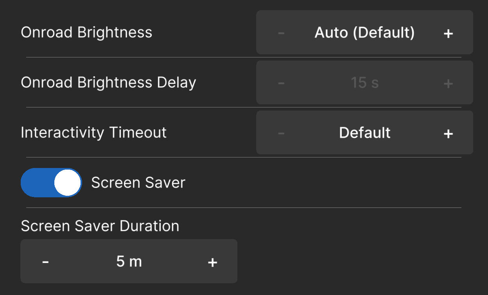
  <figcaption>comma 3X</figcaption>
</figure>

<noscript markdown="1">

| Setting | Default | What it does |
| --- | --- | --- |
| brightness / Onroad Brightness | auto | Screen brightness while driving, after the brightness delay. Auto (dark) can go dimmer. Alerts brighten the screen. |
| brightness delay / Onroad Brightness Delay | 10 min | Wait before the brightness setting applies. Greyed while brightness is auto or auto (dark). |
| ui timeout / Interactivity Timeout | default | How long settings stay open without a touch. |
| screen saver / Screen Saver | On | Shows a screen saver when offroad and idle, instead of a dark screen. |
| saver duration / Screen Saver Duration | 5 min | How long the screen saver runs before the screen turns off. Greyed with screen saver off. |

</noscript>

## Visuals

<figure class="settings-strip settings-figure-mici" tabindex="0" aria-label="Visuals panel on comma 4, scrolls sideways">
  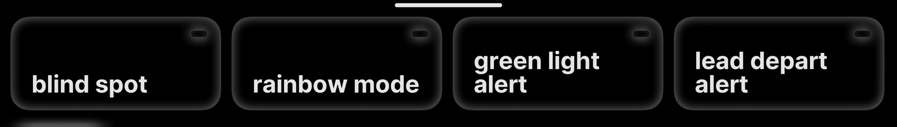
  <figcaption>comma 4</figcaption>
</figure>
<figure class="settings-shot settings-figure-tici">
  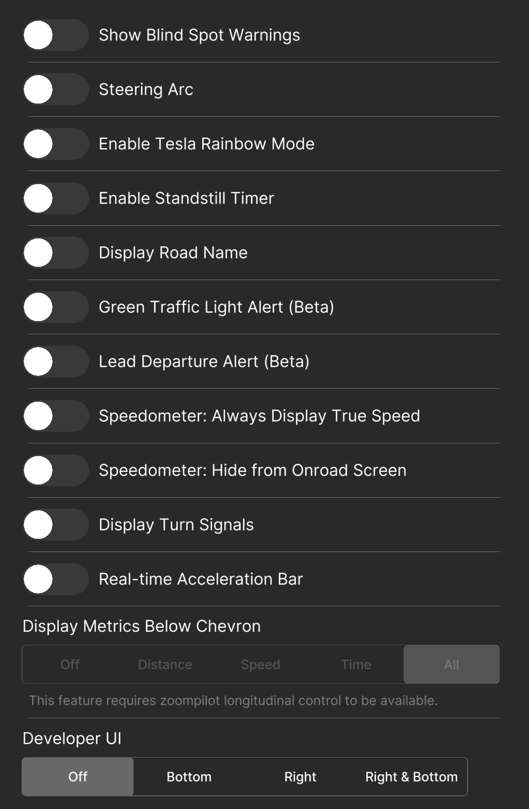
  <figcaption>comma 3X</figcaption>
</figure>

<noscript markdown="1">

| Setting | Default | What it does |
| --- | --- | --- |
| blind spot / Show Blind Spot Warnings | Off | Shows a warning when a car is in your blind spot. Greyed on cars without blind spot monitoring. |
| rainbow mode / Enable Tesla Rainbow Mode | Off | Draws the driving path as a rainbow. Cosmetic only. |
| green light alert / Green Traffic Light Alert (Beta) | Off | Chimes when your light turns green with no car ahead. Only while cruise is not engaged. Check the road before you go. |
| lead depart alert / Lead Departure Alert (Beta) | Off | Chimes when you're stopped and the car ahead pulls away. Only while cruise is not engaged. |
| Steering Arc | Off | comma 3X only. Draws the steering arc on the driving screen. |
| Enable Standstill Timer | Off | comma 3X only. Shows a timer when stopped. |
| Display Road Name | Off | comma 3X only. Needs OpenStreetMap data for your area. |
| Speedometer: Always Display True Speed | Off | comma 3X only. Shows wheel-speed-sensor speed on supported cars. |
| Speedometer: Hide from Onroad Screen | Off | comma 3X only. Hides the speedometer. |
| Display Turn Signals | Off | comma 3X only. Draws turn indicators on the HUD. |
| Real-time Acceleration Bar | Off | comma 3X only. Shows how hard the car is accelerating or braking. |
| Display Metrics Below Chevron | All | comma 3X only. Shows lead car data under the chevron. Needs openpilot longitudinal control. |
| Developer UI | Off | comma 3X only. Real-time debug values. |

</noscript>

## Toggles

<figure class="settings-strip settings-figure-mici" tabindex="0" aria-label="Toggles panel on comma 4, scrolls sideways">
  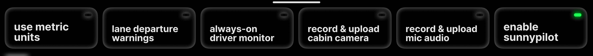
  <figcaption>comma 4</figcaption>
</figure>
<figure class="settings-shot settings-figure-tici">
  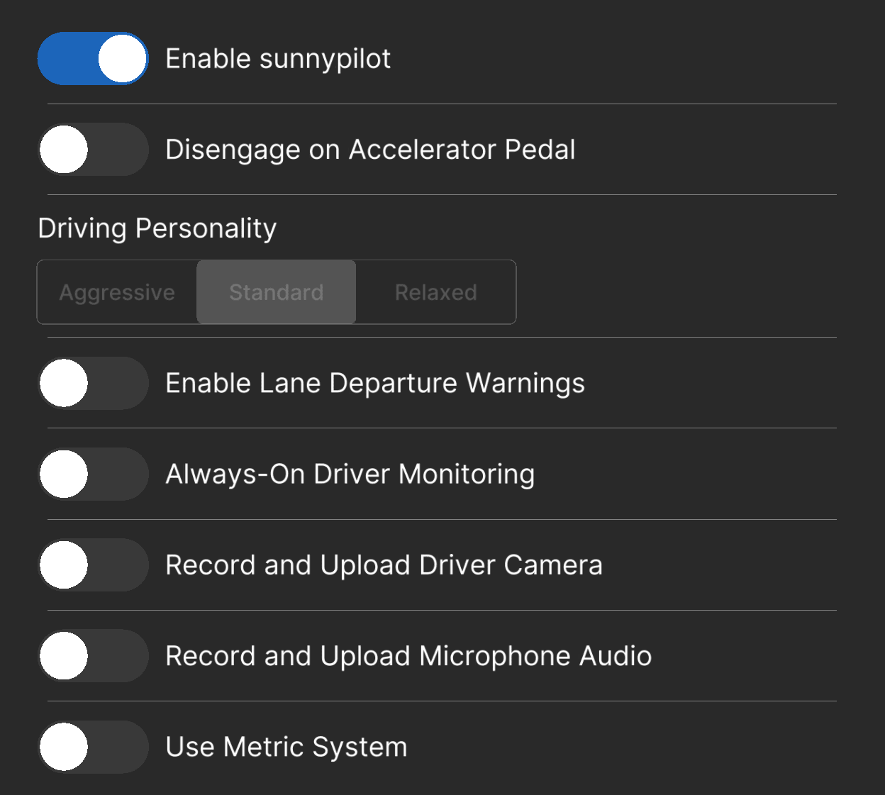
  <figcaption>comma 3X</figcaption>
</figure>

<noscript markdown="1">

| Setting | Default | What it does |
| --- | --- | --- |
| driving personality / Driving Personality | standard | Following distance and gas and brake style. Shown only with openpilot longitudinal control (alpha longitudinal on Mazda). |
| use metric units / Use Metric System | Off | km/h instead of mph. |
| lane departure warnings / Enable Lane Departure Warnings | Off | Warns when you drift over a lane line above 31 mph (50 km/h) without signaling. |
| always-on driver monitor / Always-On Driver Monitoring | Off | Monitors the driver even when zoompilot is not engaged. |
| record & upload cabin camera / Record and Upload Driver Camera | Off | Uploads cabin camera data to improve driver monitoring. Applies next drive. Greyed while engaged. |
| record & upload mic audio / Record and Upload Microphone Audio | Off | Adds microphone audio to dashcam videos. Applies next drive. Greyed while engaged. |
| enable sunnypilot / Enable sunnypilot | On | Master switch for zoompilot. Off uses your car's stock driver assistance. Greyed while engaged. |
| Disengage on Accelerator Pedal | Off | comma 3X only. Pressing the gas disengages. Off: the gas overrides without canceling. |

</noscript>

## Network

<figure class="settings-strip settings-figure-mici" tabindex="0" aria-label="Network panel on comma 4, scrolls sideways">
  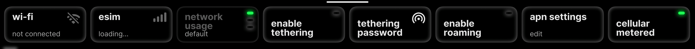
  <figcaption>comma 4</figcaption>
</figure>
<figure class="settings-shot settings-figure-tici">
  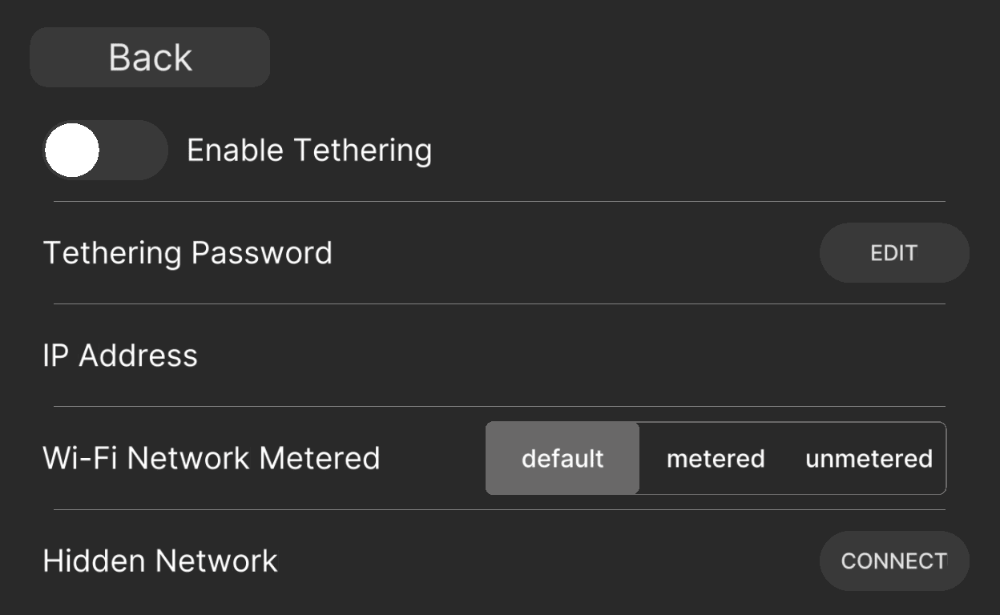
  <figcaption>comma 3X</figcaption>
</figure>

<noscript markdown="1">

| Setting | Default | What it does |
| --- | --- | --- |
| network usage / Wi-Fi Network Metered | default | For the current Wi-Fi. Metered stops large uploads on it. |
| enable tethering / Enable Tethering | Off | Shares the device's internet through a Wi-Fi hotspot. |
| tethering password / Tethering Password | Device default | Password for the hotspot. |
| enable roaming / Enable Roaming | Off | Allows cellular data roaming. Hidden with full comma prime. |
| apn settings / APN Setting | Blank (automatic) | The access point name your cellular carrier needs. Hidden with full comma prime. |
| cellular metered / Cellular Metered | On | Stops large uploads over cellular. Hidden with full comma prime. |

</noscript>

## Device

<figure class="settings-strip settings-figure-mici" tabindex="0" aria-label="Device panel on comma 4, scrolls sideways">
  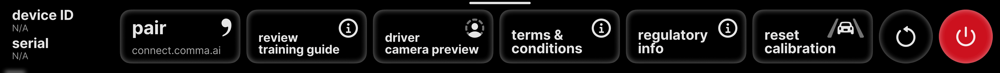
  <figcaption>comma 4</figcaption>
</figure>
<figure class="settings-shot settings-figure-tici">
  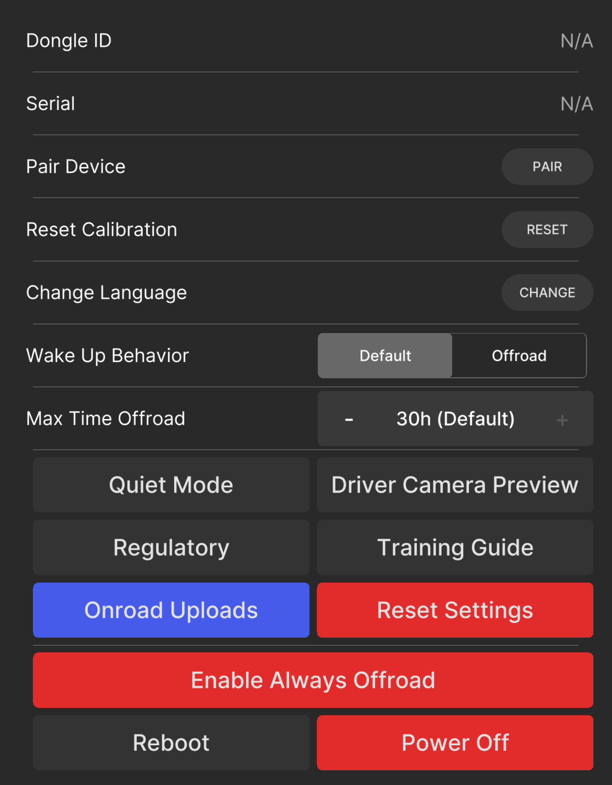
  <figcaption>comma 3X</figcaption>
</figure>

<noscript markdown="1">

| Setting | Default | What it does |
| --- | --- | --- |
| enable always offroad / Enable Always Offroad | Off | Keeps the device offroad with the car on, so zoompilot won't engage. On comma 4, a button in the main settings list; exit always offroad ends it. Disengage first. With alpha longitudinal on Mazda, zoompilot hands the radar back first, even while moving. |
| Change Language | English | comma 3X only. Device language. |
| Wake Up Behavior | Default | comma 3X only. Offroad starts the device in always offroad after boot or sleep. |
| Max Time Offroad | 30 h | comma 3X only. Shuts the device down this long after the engine goes off. |
| Quiet Mode | Off | comma 3X only. Fewer sounds. |
| Onroad Uploads | On | comma 3X only. Uploads route logs while driving. |

</noscript>

## Software

<figure class="settings-strip settings-figure-mici" tabindex="0" aria-label="Software panel on comma 4, scrolls sideways">
  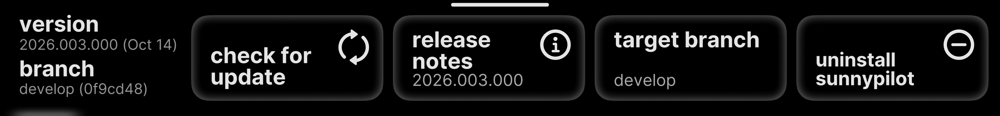
  <figcaption>comma 4</figcaption>
</figure>
<figure class="settings-shot settings-figure-tici">
  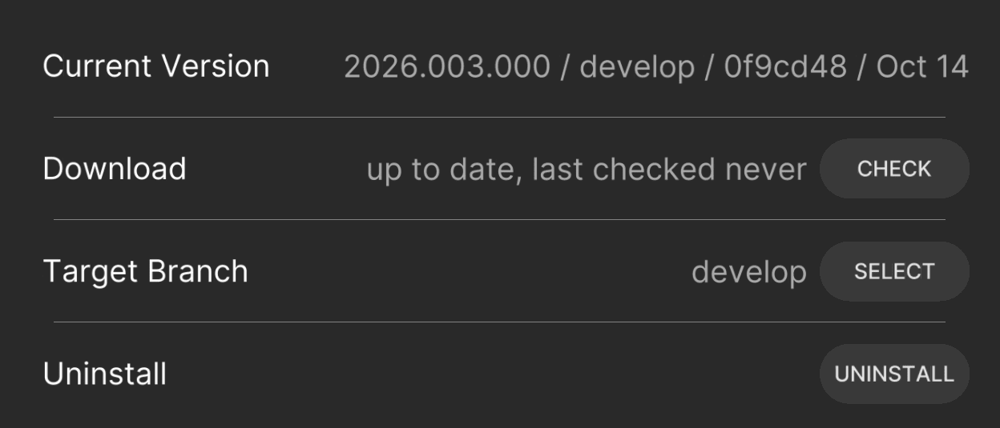
  <figcaption>comma 3X</figcaption>
</figure>

<noscript markdown="1">

| Setting | Default | What it does |
| --- | --- | --- |
| target branch / Target Branch | Installed branch | The branch the next update check downloads. Offroad only. Hidden on tested branches. |
| Disable Updates | Off | comma 3X only. Stops over-the-air updates. Needs Show Advanced Controls. Keep updates on to get releases. |

</noscript>

## sunnylink

<figure class="settings-strip settings-figure-mici" tabindex="0" aria-label="sunnylink panel on comma 4, scrolls sideways">
  
  <figcaption>comma 4</figcaption>
</figure>
<figure class="settings-shot settings-figure-tici">
  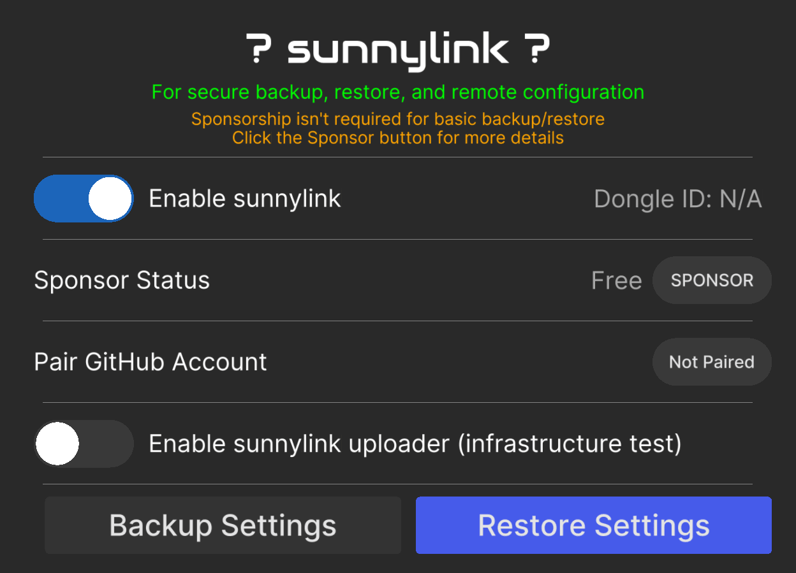
  <figcaption>comma 3X</figcaption>
</figure>

<noscript markdown="1">

| Setting | Default | What it does |
| --- | --- | --- |
| enable sunnylink / Enable sunnylink | On | Backups, map downloads, and remote settings. Off stops all sunnylink requests. |
| sunnylink uploader / Enable sunnylink uploader (infrastructure test) | Off | Uploads driving data to sunnylink servers. A test for top sponsor tiers; does nothing for you yet. Shown with sunnylink on. |

</noscript>

## Developer

<figure class="settings-strip settings-figure-mici" tabindex="0" aria-label="Developer panel on comma 4, scrolls sideways">
  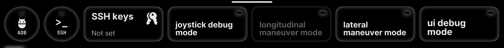
  <figcaption>comma 4</figcaption>
</figure>
<figure class="settings-shot settings-figure-tici">
  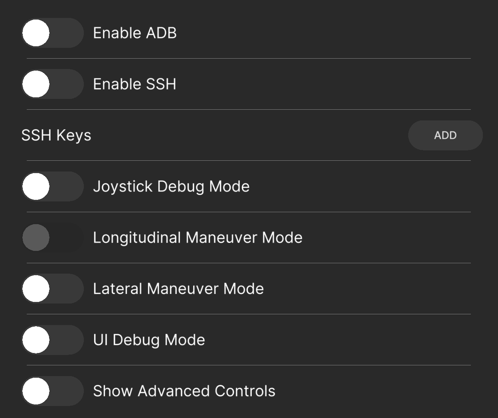
  <figcaption>comma 3X</figcaption>
</figure>

<noscript markdown="1">

| Setting | Default | What it does |
| --- | --- | --- |
| enable ADB / Enable ADB | Off | Android Debug Bridge over USB or the network. Offroad only. Greyed while Jetlink is on. |
| enable SSH / Enable SSH | Off | Remote shell access with your SSH keys. |
| SSH keys / SSH Keys | Not set | Grants SSH access to a GitHub account's public keys. Enter only your own username. |
| joystick debug mode / Joystick Debug Mode | Off | Drives the car from a joystick. Test benches only. Offroad only. Clears after each drive. |
| longitudinal maneuver mode / Longitudinal Maneuver Mode | Off | Runs a gas and brake test sequence. Not for road use. Needs openpilot longitudinal control. Offroad only. Clears after each drive. |
| lateral maneuver mode / Lateral Maneuver Mode | Off | Runs a steering test sequence. Not for road use. Offroad only. Clears after each drive. |
| ui debug mode / UI Debug Mode | Off | Shows touch points and the frame rate. |
| Show Advanced Controls | Off | comma 3X only. Reveals advanced settings across panels. |
| GitHub Runner Service | Off | comma 3X only. For zoompilot development builds. |
| copyparty Service | Off | comma 3X only. Browse and download your routes from a browser on your network. Needs Show Advanced Controls. |
| Quickboot Mode | Off | comma 3X only. Faster boot. Needs updates disabled and Show Advanced Controls. |

</noscript>

## other panels

- **Trips** and **Firehose** have no settings.
- **OSM (comma 3X):** downloaded maps.
- **Vehicle (comma 3X):** automatic car identification. Do not force a different car to unlock features.
